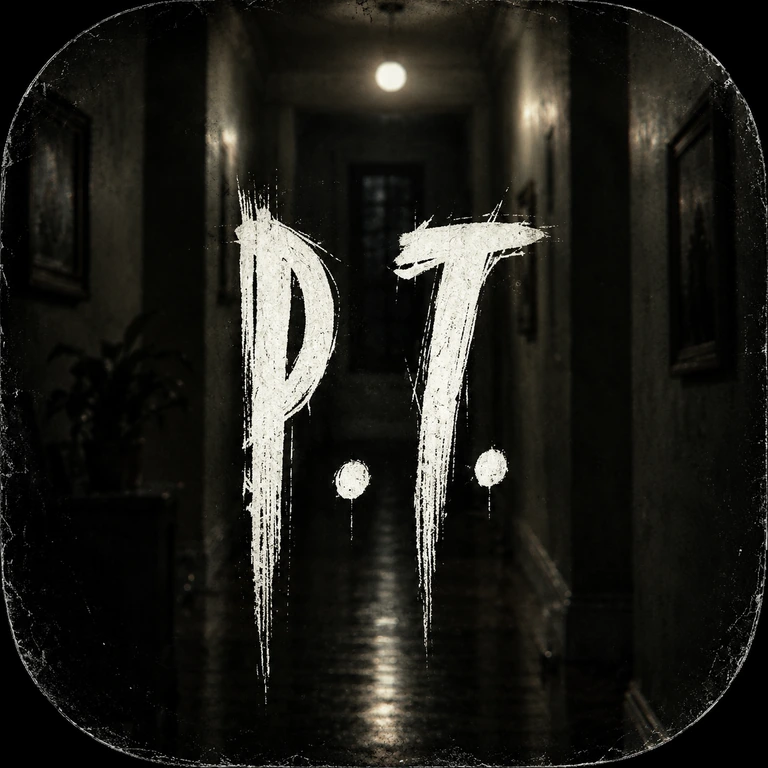
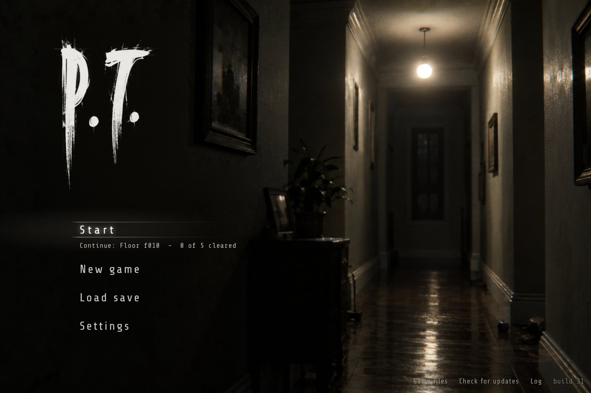
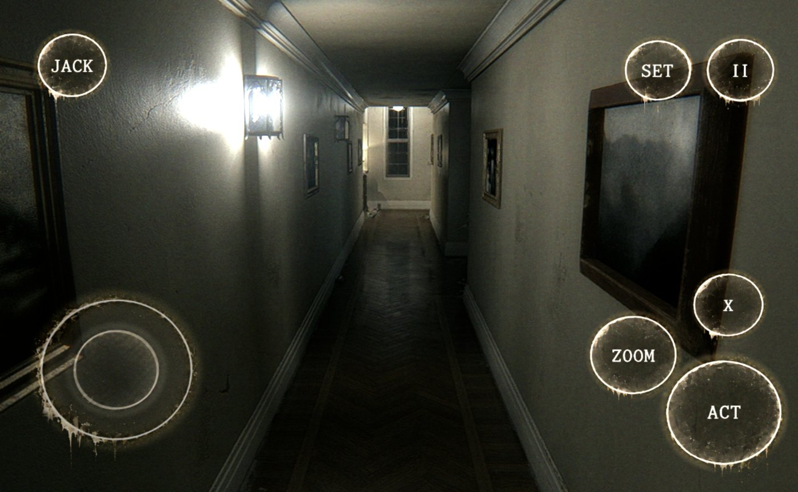

  

# P.T. Android Port

A native Android app of **P.T.**, the 2014 PS4 teaser by Kojima Productions. It is built on the
[P.T. PC port](https://github.com/LoreanXavier/pt-pc) by LoreanXavier: the game logic rebuilt in C++ from the original's behaviour,
with a renderer on Vulkan 1.3 and SDL3. This fork brings that code to arm64 Android, adds touch controls, a settings panel for phone
and tablet GPUs, an in-app updater and a main menu made after the game's own title screen. It is not an emulator.

Every level, model, texture, sound, script and cutscene is read at run time from **your own copy of the PS4 game**. The repository and
the APK contain no game data.

**Version 1.00.** The first public release. It has been tried on one device so far (see [Status](#status-and-known-issues)).

| Main menu | In game with touch controls |
|---|---|
|  |  |

[Download](#download-and-install) · [What you need](#what-you-need) · [Controls](#controls) · [Features](#features) ·
[Status](#status-and-known-issues) · [Reporting a problem](#reporting-a-problem) · [Building](#building) · [Credits](#credits-and-legal)

## What you need

- **Android 10 or newer, arm64**, with a GPU and driver that offer **Vulkan 1.3** and the features the renderer checks for at start
  (the log names a missing one). A recent Snapdragon, Mali or Immortalis chip on Android 13 or newer is the realistic floor.
- **Your own copy of P.T.**, the US release **CUSA01127**, either:
  - a **dump folder** from your own console (it holds `chunk1.psarc` and `texture.qar`, anywhere inside the folder you pick), or
  - a **fake PKG (fPKG)** made from such a dump.

  A PlayStation Store (retail) PKG cannot be used: it is encrypted for the console that owns the licence, and nothing in this
  project decrypts it. No game files are provided or linked here.
- **Free space** for a second copy of those two files (several GB): the app copies them, or extracts them from the fPKG, into its
  private storage once. The APK itself is about 70 MB.

## Download and install

1. Open the [Releases](https://github.com/DrTron1c/P.T.-Android-Port/releases) page and download `P.T.PC.Port-Android-arm64.apk` from the newest **P.T. Android Port**
   release (the tag is `v1.00` for version 1.00). Open the file and allow installs from the browser or file manager you used.
   Play Protect may warn about an app it does not know: it is a sideloaded build.
2. Start the app. The first start asks for the game: choose the dump folder (or the two files themselves), or **Or choose a fake PKG**.
   Keep the screen on until the copy is done. The main menu opens afterwards.
3. Start. Settings, the save and the log are in the app's private storage; uninstalling the app deletes them and the copied game
   files.

**Updates.** Each time the app starts, the main menu asks this repository's Releases whether there is a newer version, and the **Check for
updates** entry of the menu asks again whenever you touch it. A strip over the menu, in the style of the title screen, says that it
is looking, that a version is available and how far the download is, or that you are up to date. The download is handed to Android's
installer after its SHA-256 has been checked against the digest GitHub lists for the file. The first time, the strip asks you to
**Allow** the app to install updates (an Android settings page opens) or to leave it for **Later**. Imported game files and settings stay. Every version is signed with the same key, so
a newer APK also installs over an older one by hand. Only full releases count: drafts and pre-releases are skipped.

The signing key (`android/pt-port.keystore`) is a throwaway key kept in the repository so that updates keep the game files; it makes
the app updatable, it is not proof that an APK came from here. Take APKs from this repository's Releases only. Builds are marked
debuggable so the log can be read with `adb run-as`.

## Controls

| Control | Touch |
|---|---|
| Walk | put a thumb anywhere in the left part of the screen; the stick appears under it |
| Look | drag a finger anywhere else |
| **ACT** | the action button (cross) |
| **ZOOM** | hold to zoom (R3) |
| **X** | the X-mark action |
| **II** | the game's pause menu |
| **SET** | the settings panel, over the running game |
| **JACK** | stands in for saying "Jack" in the one part of the game that listens for it: tap it when the game listens |
| Back button | opens the menu |

The buttons are drawn from a HUD picture (rings with grimy edges and drips, the stick and its thumb); a button that is held glows
and grows a little. A Bluetooth or USB controller works as a PS4 pad (SDL gamepad support); the on-screen controls hide while a
controller is in use and come back at the next touch. In menus a finger is the pointer.

## Features

**Main menu.** The title screen's hallway with its one flickering bulb, the brush logo and the entries in Share Tech: Start, New
game, Load save, Settings and Check for updates, with "Continue: Floor … – N of 5 cleared" under Start and the version (for example
"version 1.00") in the corner. Low ominous music, the bulb's static buzz, wood creaks and now and then footsteps on a wooden floor
play behind it (**Settings > Menu sound** turns it off). The other screens (settings, saves, log) are in the same dark, off-white style.

**Settings panel** (the SET button in game, Settings in the menu), in the style of the title screen:
- Presets **Fastest, Fast, Balanced, Original**, and every graphics option on its own; the first start applies the Low preset.
- **Picture size**: the game draws into a fixed-size surface (1080 lines by default; Screen, 1440 down to 480 to choose) that Android scales to the
  screen, which is the biggest speed lever on a phone or tablet. An experimental **automatic picture size** lowers it while the
  GPU cannot keep the frame rate and raises it again when it can.
- **Frame rate limit** and v-sync; the limit is also given to Android as a frame rate hint so the display runs at it or a multiple.
- **Frame counter**: Off, Frame rate, or Detailed (GPU and CPU time of a frame, picture size).
- **Built-in temporal upscaler** (experimental, off by default): the desktop's FSR, DLSS and XeSS are Windows or vendor code, so
  Android has its own jittered temporal upscaler as shaders, which draws the scene at 2/3 or 1/2 of the picture size and rebuilds
  the full size picture from earlier frames. Settings > Upscaler has Quality and Sharpness.

**Saves.** *Load save* shows the current save (floor, cleared, Game+), Continue, Back up now, Save to a file, Choose a save file
(also a PC save) and the list of backups with Put back and Delete. Anything that replaces a save keeps the old one first.

**Game files.** A dump folder or an fPKG is imported in the app; the fPKG reader (`PkgExtractor.java`) is the Java form of what the
desktop installer does with LibOrbisPkg.

**When something goes wrong.** The **Log** screen shows the device, settings, fps, GPU milliseconds per part of the frame, warnings and
errors. If the game crashed, was killed for memory or hung, the menu shows a report (device, how the run ended, the native
backtrace, the tail of `pt.log`, logcat) with Copy and Share.

## How it differs from the desktop port

| | Android |
|---|---|
| Spoken word recognition | not built (whisper.cpp left out): use the **JACK** button |
| Upscalers | FSR, DLSS, XeSS and MetalFX are greyed; the **Built-in** upscaler is the Android option |
| Ray-traced shadows, AO and reflections, VR | off |
| Enhanced textures (Real-ESRGAN), mods folder, LiveSplit | not available |
| Fake PKG on the device | yes (extracted on the device); a store PKG is refused |
| Keyboard shortcuts such as photo mode (F7) and free camera (F6) | no touch button; a connected keyboard is untried |
| Graphics defaults | Low preset, 1080-line picture |

Everything else is the desktop game: the same loops, story, Museum and Game+. The desktop port's features and files are described in
[docs/pc-port.md](docs/pc-port.md).

## Status and known issues

- **Tested hardware: one device**, a Snapdragon 8 Gen 2 (Adreno 740), where the game, the menu and the touch controls run well. Other
  Snapdragon generations, Mali, Immortalis and Tensor GPUs are untried; the renderer's feature check names what a GPU lacks.
- **Adreno 740 compute bug (fixed).** On that GPU compute shaders ran every work group but wrote only part of their output, which left
  the picture dark in the lit hallway (the exposure meter read garbage) and, with the first upscaler, most of the screen black. The
  exposure meter, the flashlight reflection and the upscaler now run as full-screen draws. On another GPU, if the
  picture is still very dark, open **Log > Share** and look for the `exposure` lines: they are what is needed.
- **Speed.** Mobile GPUs differ a lot; the Low preset and a 1080-line picture are the defaults. The built-in upscaler and the
  automatic picture size are experimental.
- **Less tried:** the in-app updater (written from Android's documentation; the installer's confirmation page differs between
  makers; version 1.00 is the first release it can find), the fPKG import (tested on synthetic packages and not on a real fPKG), the touch layout on other screen shapes, and a full
  playthrough on Android (none reported yet; the desktop port's scripted walkthrough does not run here).

More detail, with the diagnosis notes, is in [docs/android.md](docs/android.md).

## Reporting a problem

Open an issue with the **Android bug report** form. Please include the version (bottom right of the main menu), the device and
Android version, what happened and how to make it happen again, and the report from **Log > Copy / Share** (after a crash the menu
shows one). Problems with the Windows, Linux or macOS versions belong with the
[desktop port](https://github.com/LoreanXavier/pt-pc).

## Building

CI does it for you: `.github/workflows/android.yml` builds the native code and the APK on GitHub's Linux runner for every push to
the `android` branch, or on demand (**Actions > Android > Run workflow**), keeps the APK as a workflow artifact and pushes a short
log of the run to the `ci-logs` branch. The version is written once, in `android/version.txt`; it is the app's version name, the number
shown in the menu and in the game's options, and the name of the release tag (`v1.00`). When a build finds that version has no release yet,
it publishes the APK as the release of that version (with the notes of `android/release-notes/`). The versionCode is the CI run number.

Locally: Android NDK r26 or newer, CMake 3.28, Ninja, Python 3, JDK 17 and Gradle 8.7 or newer.

    export ANDROID_NDK_HOME=/path/to/ndk
    tools/android/build.sh native      # libmain.so, libSDL3.so, shaders, fonts, HUD: staged into android/app
    tools/android/build.sh apk         # Gradle: dist/P.T.PC.Port-Android-arm64.apk

The APK keeps the file name `P.T.PC.Port-Android-arm64.apk` because installed builds look for that name when they update.

| Where | What |
|---|---|
| `android/` | the Gradle project and the Java layer: menu, game import, updater, saves, settings panel, crash report |
| `src/engine/platform/android_platform.cpp`, `touch_controls.cpp` | the executable folder, the touch overlay and the Android side of the settings |
| `tools/android/` | `build.sh`, `stage.py` (puts libraries, shaders, fonts and the HUD into the APK), `menu_sounds.py` (makes the menu's sounds), `pkgtest/` |
| `src/`, `shaders/`, `third_party/` | the desktop port's game, renderer and dependencies, shared with Android |
| `docs/android.md` | the full Android notes |
| `docs/pc-port.md` | the desktop port's own README |

Branches: **`android`** is where the port is built (a push to it starts the CI; a push that only changes the README or the docs does
not) and `main` is kept at the same commit, so this page shows the same README on either; `ci-logs` holds the CI's latest short log.
The desktop port itself lives upstream at [LoreanXavier/pt-pc](https://github.com/LoreanXavier/pt-pc).

The game runs in its own process (`:game`) next to the menu, because SDL cannot start the game's `main` twice in one process; the
process ends with the game and the next Start gets a new one.

## Credits and legal

P.T. is the work of Kojima Productions and is owned by Konami. This project is not affiliated with, endorsed by or connected to
either of them, and does nothing without your own copy of the game. The main menu's hallway picture and logo and the app icon are
made from stills of the game's title screen and icon, and the touch HUD from a design supplied for this project; the artwork is not
this project's, and it will be taken out on request.

- **LoreanXavier**, author of the [P.T. PC port](https://github.com/LoreanXavier/pt-pc) this is built on, and its contributors
  (listed in [docs/pc-port.md](docs/pc-port.md)). The shadPS4 emulator was the desktop port's reference for how the original
  behaves.
- SDL3, Vulkan (volk, VMA), glm, Dear ImGui, stb, Lua 5.1, libogg and libvorbis, as in the desktop port; LibOrbisPkg (Maxton) for the
  PKG format the Java importer follows.
- libadrenotools and liblinkernsbypass (Billy Laws, BSD 2-Clause; the notice is `android/app/src/main/java/com/ptport/android/LICENSE-libadrenotools.txt`)
  for the custom GPU driver.
- Share Tech and Share Tech Mono (The Share Tech Project Authors), SIL Open Font License 1.1 (the licences are in `android/app/src/main/res/raw`).
- The menu's music and sounds are generated from noise and sine waves by `tools/android/menu_sounds.py`; nothing in them is sampled
  from a recording.

## AI disclosure

The Android port was written with Claude (Anthropic) in Claude Code sessions, and the desktop port it builds on was written with AI
tools as well (see [docs/pc-port.md](docs/pc-port.md)). The CI is the only compiler the Android code has had; it is tested by hand on
the device above.

## Licence

The port's own code is under the MIT licence (see [LICENSE](LICENSE)), the Android additions included. The third-party pieces keep
their own licences.
